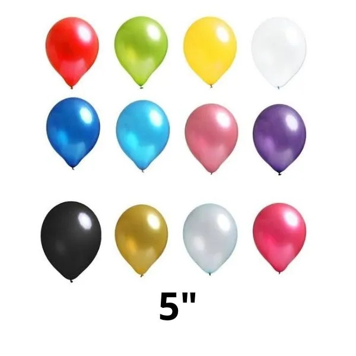
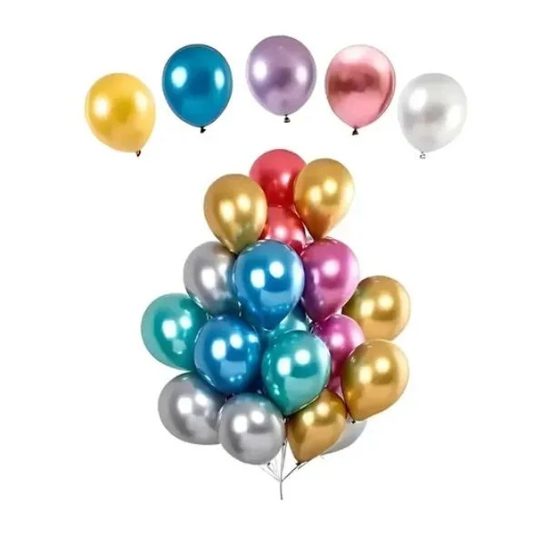
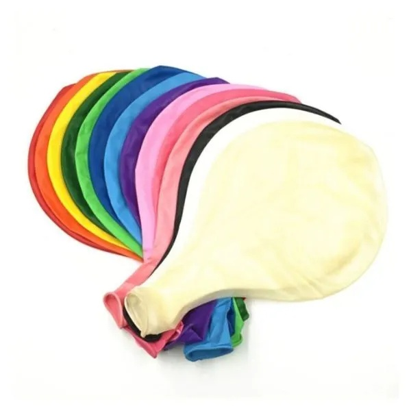
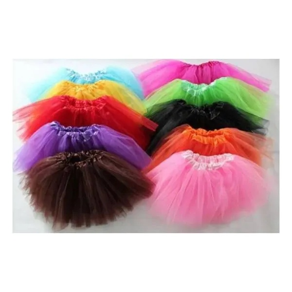
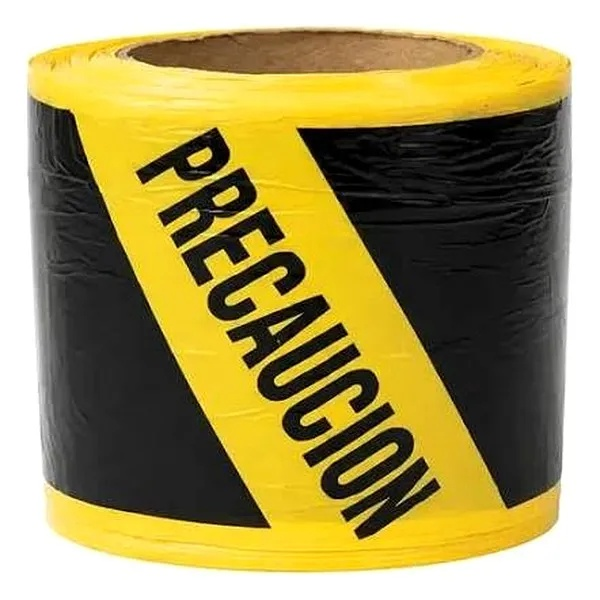

# Seis altas faltantes de Cotillón

**Preparación en PR draft. Sin merge ni ejecución en producción.**

## Lote solicitado

| ID de Rappi | Nombre que se mostrará | Precio | Stock | Categoría preparada |
|---|---|---:|---:|---|
| 2115454129 | Globo Surtido 5p | $100 | 314 | COTILLÓN › Cumpleaños infantil › Decoración |
| 2115454122 | Globos Surtidos Chrome | $350 | 153 | COTILLÓN › Cumpleaños infantil › Decoración |
| 2115454124 | Globos Surtidos Std | $200 | 709 | COTILLÓN › Cumpleaños infantil › Decoración |
| 2115456032 | Piñata Globo Surtida 20" | $2.000 | 84 | COTILLÓN › Cumpleaños infantil › Bolsas y piñatas |
| 2115454118 | Tutús Surtidos | $8.000 | 10 | COTILLÓN › Fiestas › Alas y tutús |
| 2115454258 | Cinta De Precaución Amarilla X Metro | $200 | 190 | DESCARTABLES › Hilos y cintas |

Los precios y stocks son los pedidos por el dueño. Las categorías son propuestas dentro de las 51 categorías ya presentes en la copia; no se crean ni se modifican categorías. No se consultó ni se escribió la web o la hoja de producción.

## Origen y revisión de las fotos

Se usó exclusivamente el índice excel-tienda/entradas/Fotos-catalogo-disfraz-cabezon-2026-10-27/indice-fotos-2026-10-27.csv, cruzando por ID de Rappi. Cada ID tiene una única fila. El JSON conserva el nombre del índice, archivo, URL original y código/SKU. El nombre del índice para Chrome es «Globo Surtidos Chrome»; el nombre mostrado conserva «Globos Surtidos Chrome», como pidió el dueño. Se verificó también la ausencia de ambos nombres en la copia.

Se abrió cada foto local: todas son JPEG de 600 × 600, muestran el producto indicado y tienen calidad utilizable de catálogo. Se copiaron los bytes originales; no hubo retoque ni generación de imágenes. La foto de Cinta muestra el rollo, pero el nombre conserva explícitamente la venta por metro. Las fotos de surtidos son representativas de varios colores.

**Productos sin foto buena: ninguno de los seis.** Si una revisión posterior rechaza una foto, el módulo admite photoApproved:false con motivo obligatorio: crea la ficha inactiva, sin descargar esa imagen ni subirla a Cloudinary. Eso requiere un nuevo JSON, nuevo SHA-256 y revisión antes de ejecutar.

| Producto | Foto revisada | SHA-256 de los bytes |
|---|---|---|
| Globo 5p |  | 8a62292f050dd6028ab62d94d985b65b214c84a24128a4d5cb78c84749a9b01b |
| Chrome |  | b1dc487a7d379d07b23a6c33df3afbe78c50b39159d82cf032087e2679450c83 |
| Std |  | 902a1551abcae63eb01bf300543c5db26eb74d200668312136962251dfae1cbe |
| Piñata |  | b72ff56165635f77bcbf4f22f67140d873af5c04664a524da9319187bc01ece8 |
| Tutús |  | c3a87afd9f847196dc3358f7348996ed01eac285fabdbe3996feb614b31bf3b6 |
| Cinta |  | f48cf4c6e3cb3ab6752c87f8edb2da2cb0a082ce00be2cdcaceb92086b9da1f2 |

## Integridad y mecanismo incremental de #8

- Módulo nuevo: [CotillonSeisRappi20261028.gs](CotillonSeisRappi20261028.gs). Reutiliza las funciones de acceso a filas, categorías y comprobación HTTP de [CotillonIncremental20261027.gs](CotillonIncremental20261027.gs), y los auxiliares existentes de Code.gs. Esos dos módulos quedan intactos.
- Fuente: [import-cotillon-seis-rappi-2026-10-28.json](import-cotillon-seis-rappi-2026-10-28.json).
- SHA-256 del JSON UTF-8 con LF: **9bc98afb0181c3928f7a377350fee9933c263c9c679f157f3c2a302ca7e6aae3**. La regla nueva de backend/.gitattributes afecta únicamente a este JSON.
- Identidad por sourceId e ID excel-<sourceId>. Un ID, sourceId o nombre ajeno que coincida detiene el lote completo antes del respaldo o escritura. No convierte una ficha ajena en propia.
- Solo altas: nunca modifica fichas ajenas al lote ni reemplaza sus precios, stocks, nombres, categorías o fotos. La reanudación normal de sus propias altas no vuelve a escribirlas; el reintento explícito de fotos conserva sus otros campos.
- Respaldo anterior a la primera escritura, registrado con nombre e ID de hoja. Si desaparece o se cambia el ID, el proceso se detiene.
- Lotes de hasta 15 operaciones; el lote actual tiene seis. También se probaron tres lotes de dos y una repetición de cero.
- En copia, las seis altas quedan inactivas y sin subida de fotos, aunque todas sus fotos estén aprobadas.
- Para una carga real posterior: aprobación SHA-256 independiente de #8, comprobación de los bytes de cada foto, subida por el flujo firmado existente de Cloudinary y HTTP 200 con tipo imagen en foto y miniatura finales antes de activar.
- Un cambio de SHA de foto, un fallo de subida o una miniatura 404 deja la ficha inactiva con estado de error. Un reintento explícito completa solo esas fotos sin duplicar filas ni reemplazar sus otros campos.

## Prueba en copia nativa de Google Sheets

[Copia procesada: PRUEBA 6 faltantes Rappi Cotillón 2026-10-28 - NO PRODUCCION](https://docs.google.com/spreadsheets/d/1u1cN2569dN7gP_V46iAnzRj4c7OpIO5OCakOeJ41f_M/edit).

Se duplicó la copia procesada de #8, no producción. Se leyeron sus 1.313 productos y 51 categorías. Ninguno de los seis IDs ni los nombres solicitados aparecía allí. El módulo Apps Script nuevo se ejecutó localmente mediante VM con esos datos y servicios simulados. Sus seis filas de salida se escribieron en la copia nativa nueva.

Antes de agregar filas se duplicó cotillon como cotillon_respaldo_seis_20261028_test. Se conservaron también las pestañas previas de #8.

| Comprobación | Resultado |
|---|---:|
| Productos de la copia antes | 1.313 |
| Altas aplicadas | 6 |
| Productos después | 1.319 |
| Conflictos | 0 |
| Escrituras en la segunda ejecución simulada | 0 |
| Altas activas en la copia | 0 |
| Fotos subidas a Cloudinary | 0 |
| Productos sin foto aprobada en este lote | 0 |

Se leyó de vuelta la totalidad de cotillon!A1:B1320, del respaldo A1:B1314 y de categorias_cotillon!A1:B52. Las 1.313 fichas anteriores no cambiaron, las seis filas nuevas coinciden exactamente con la simulación, el respaldo coincide celda por celda con la entrada y las 51 categorías permanecen iguales. Se revisaron los metadatos de las celdas nuevas: valores literales JSON, sin validaciones ni fórmulas a reemplazar, conservando el formato de las filas vecinas.

La sesión de Google del navegador no tenía acceso a la cuenta de la copia; no se solicitaron permisos ni se cambió el acceso compartido. La verificación se hizo por lectura completa y metadatos de la API. No se afirma una revisión visual de la hoja en el navegador.

El archivo .gs **no se ejecutó dentro de Google Apps Script**, ni se subieron imágenes reales. La prueba combina ejecución local del módulo y verificación de sus resultados en una copia nativa, igual que la preparación de #8.

Evidencia resumida y hashes de la entrada: [verificacion-cotillon-seis-rappi-2026-10-28.json](verificacion-cotillon-seis-rappi-2026-10-28.json).

## Validación del proyecto

- 10/10 pruebas nuevas del lote: JSON, precios y stocks, hashes de fotos, vista previa sin escritura, lotes/reanudación, datos manuales, conflictos, respaldo perdido, aislamiento de copia, aprobación, foto no aprobada, SHA alterado, fallo de subida y miniatura 404.
- 74/74 pruebas de Cotillón y proyecto fuera del importador de disfraces.
- npm run typecheck: correcto.
- npm run build: correcto, con .next limpio, npm ci y backend simulado.
- Suite general: **77/79**. Dos pruebas existentes del importador de disfraces fallan porque falta tmp/disfraces-2026-10-28/disfraces-20261028-01.zip. No se copió ese ZIP ni se modificó el importador o sus pruebas para hacerlas pasar.
- Code.gs, Validation.gs, el módulo de #8 y todos los archivos del importador de disfraces permanecen sin cambios.

## Reproducir sin servicios externos

Desde la raíz:

~~~powershell
node --test tests/cotillon-six-rappi-2026-10-28.test.mjs
node scripts/simulate-cotillon-six-copy.mjs ruta/a/copia-local.json
~~~

El segundo comando recibe un JSON local con rows y categories, ambas matrices [id, registro_json] con encabezado, y devuelve el plan y las seis filas simuladas. No escribe en Google ni en Cloudinary.

Para reconstruir el lote desde las mismas fuentes locales:

~~~powershell
python scripts/build-cotillon-six-rappi-2026-10-28.py --photo-index ruta/indice-fotos-2026-10-27.csv --photos-directory ruta/Fotos-catalogo-disfraz-cabezon-2026-10-27
~~~

El generador rechaza IDs ambiguos, identidades inesperadas, archivos fuera de la carpeta, resolución insuficiente o fotos cuyo SHA-256 difiera de las revisadas. El informe no es autorización para cargar producción.
