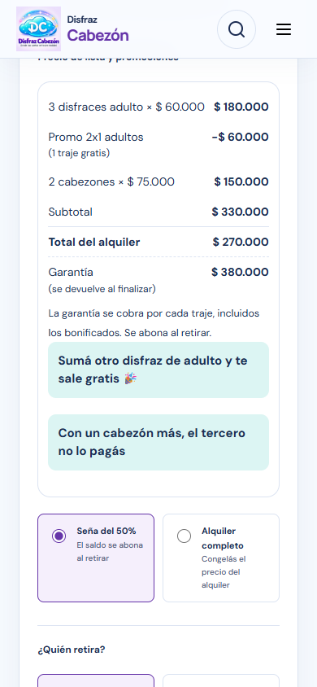
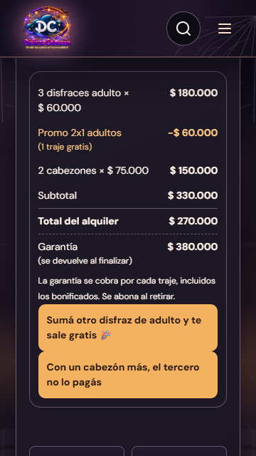
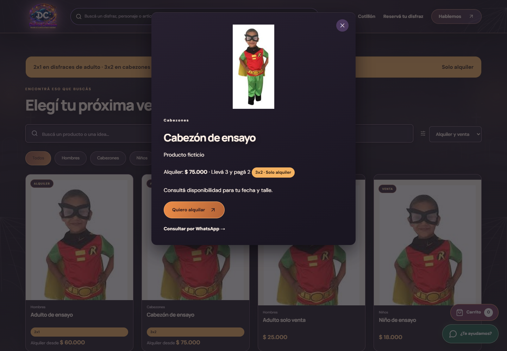
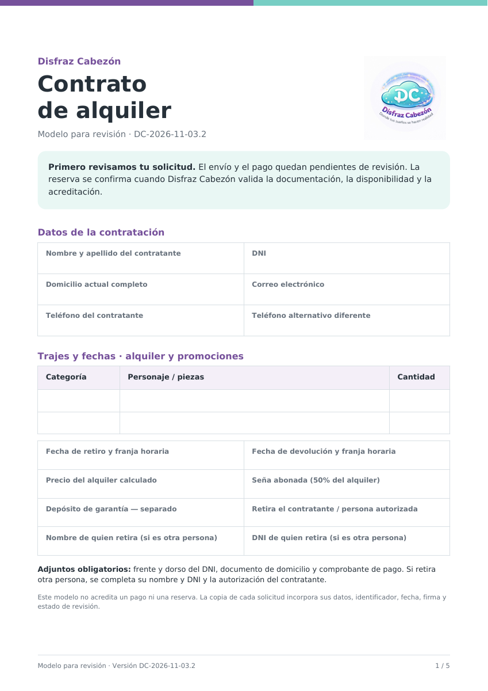

# Validación final — correcciones PR37

## Resultados

| Verificación | Resultado |
| --- | --- |
| `npm ci`, `.next` eliminada, `npm run build` con API mock | Correcto; export estático de 15 rutas |
| `npm test` | **379/379** |
| Promociones Playwright contra `out/` | **40/40**; 360×640, 390×844, 768×1024 y 1440×1000, temas default y halloween |
| Regresión de escritorio contra `out/` | **23/23**; buscador #35, registro #36, formularios, constancias, permisos e historial |
| Paridad TypeScript / Apps Script | 64 combinaciones de 0–7 adultos y cabezones, incluyendo reglas apagadas y tarifas modificadas |
| Reversión de las entradas reales | **61/61** en memoria, conservando stock y descripción posteriores; ninguna reversión en producción |
| Auditoría final, nueva lectura de la hoja real | **559 fichas / 443 alquileres / 0 diferencias de precio / 0 de garantía** |
| Contrato público | Diseño original de 5 páginas recuperado; texto extraído y las 5 páginas renderizadas y revisadas |
| Capturas públicas | **85 PNG**: 80 de páginas públicas y formularios ficticios, más 5 del contrato; [galería](capturas.html), [dimensiones y SHA-256](capturas.json) |

El catálogo se captura completo para que se lean las etiquetas y precios de las fichas corregidas. Después de mejorar el encuadre se repitieron sus 16 casos en los cuatro tamaños y dos temas. Las capturas administrativas y los CSV están únicamente en la carpeta privada indicada en el informe.

Los envíos e2e llegan a éxito exclusivamente con el backend real ejecutado en memoria y documentos, firma y comprobantes ficticios. La ruta interceptada rechaza cualquier URL de Apps Script distinta de `/s/mock/exec`. No se envían reservas ni documentos a Google. El backend de promociones no se probó ni instaló en una implementación real de Apps Script: la prueba real en copia sigue pendiente antes de su instalación aprobada.

## Cobertura de las decisiones finales

- 3 adultos + 2 cabezones: subtotal $330.000, descuento $60.000, alquiler $270.000, seña $135.000 y garantía completa $380.000. Resumen web, sidebar, Pago, resumen local, datos persistidos por servidor, correos y constancias.
- 2x1 adultos y 3x2 cabezones, grupos separados, venta/Niños excluidos, promociones activas hasta apagarlas, reglas editadas y cero vencimiento automático.
- Daddy Yankee y Lobo con 3x2. Zenon y Maui clasificados para 3x2 pero ausentes del catálogo por estar inactivos; su estado no se modificó.
- Gorila y Tiburón con Hombres principal y Cabezones secundaria conservada: **2x1 a $60.000**, porque manda la principal. Banana, Banana Fortnite y Pancho 2 en Otros: **2x1 a $60.000**.
- Deshacer la corrección desde el admin: permite cancelar/confirmar, conserva otros campos, registra la reversión y rechaza Editor, falta de sesión, revisión vieja o campos corregidos que cambiaron después. También se probó con los 61 snapshots reales en memoria, sin publicar esos datos como fixtures.
- Términos web/local y código operativo sin tarifa Premium ni importes $65.000. Los registros históricos de auditoría/importación conservan su antes, por trazabilidad; los importadores permanecen intactos.
- Contrato con logo, tablas, colores y campos originales. Tildes, ñ, comillas tipográficas y guiones largos comprobados por render y extracción. Los bloques anteriores se quitan del contenido, no se ocultan con una capa blanca.

## Incidencia del recorrido automatizado de firma

Una ejecución inicial terminó 39/40: el gesto automatizado intentó dibujar mientras el lienzo quedaba debajo del encabezado durante el desplazamiento. El formulario rechazó correctamente la firma vacía. Centrarlo por coordenadas no bastó con todos los temporizadores simulados. El test definitivo fija solamente la fecha con `clock.setFixedTime` y usa `locator.hover` para esperar estabilidad y recepción de eventos antes del trazo. No se cambió el componente de firma ni su validación. El caso aislado pasó y después la suite completa terminó **40/40, sin reintentos configurados**.

## Reproducir

```powershell
if (Test-Path -LiteralPath .next) { Remove-Item -LiteralPath .next -Recurse -Force }
npm ci
node scripts/generate-rental-pricing.mjs --check
$env:NEXT_PUBLIC_APPS_SCRIPT_URL='https://script.google.com/macros/s/mock/exec'
npm run build
npm test
npx playwright test --config=playwright.promotions.config.mjs
```

La configuración adicional sirve `out/` en 127.0.0.1:3017 y deja intacta la configuración e2e general. El backend de pruebas es simulado en memoria; nunca se usa `next dev` para esta validación. La regresión temporal selecciona `catalog-roles`, `local-forms`, `local-receipts`, `global-search` y `search-demand` en escritorio.

Regenerar el contrato con `node scripts/generate-terms-pdf.mjs`; requiere Python con pypdf y reportlab. Usa la base estilizada anterior al PR y los términos actuales del repositorio. `PDF_PYTHON` permite indicar el intérprete.








