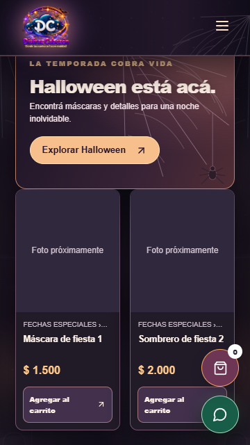
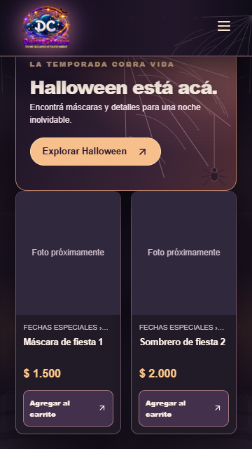
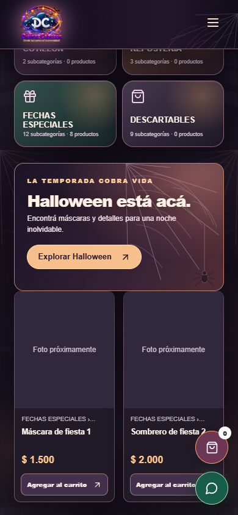
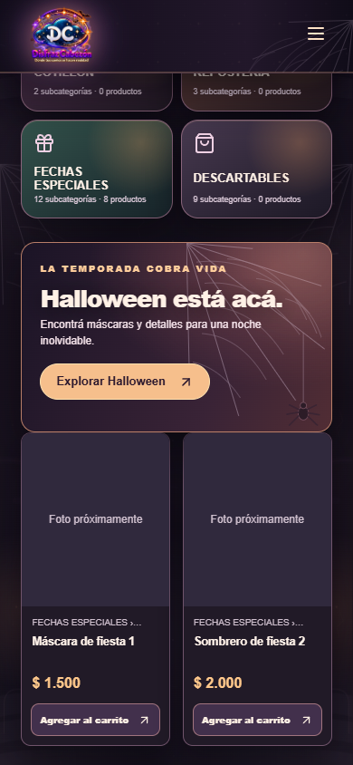
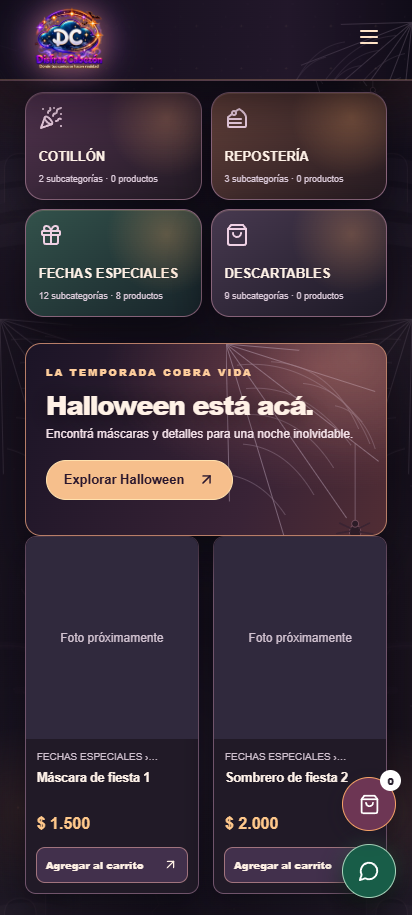
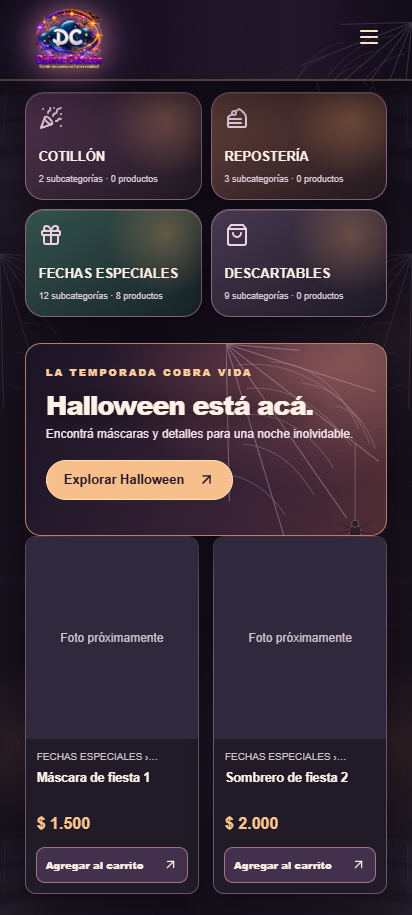

# Botones móviles y revisión local de compra

Fecha: 28 de octubre de 2026. Base: main, commit 96e2d2d.

## Cambio de interfaz

En pantallas de hasta 760 px, los accesos al carrito y WhatsApp se muestran juntos debajo de la cabecera, dentro del flujo del documento. Tienen al menos 44 × 44 px y dejan de cubrir productos, precios, botones y enlaces del pie. En escritorio conservan la posición flotante.

La fila móvil se desplaza con el documento: para usarla después de bajar hay que volver al inicio. El catálogo también conserva su botón propio de carrito. Se redujo el espacio vacío del pie que antes se reservaba para los botones flotantes.

La lógica de cantidades, almacenamiento, validación de stock y preparación de WhatsApp no se cambió. Se reubicó el componente de acceso compartido.

## Capturas antes y después

Capturas del mismo catálogo simulado, con tema Halloween, en la misma posición del producto. No se usaron datos ni servicios de producción.

| Tamaño | Antes | Después |
|---|---|---|
| 360 × 640 |  |  |
| 390 × 844 |  |  |
| 412 × 915 |  |  |

Otras vistas:

| Tamaño | Cabecera antes / después | Pie antes / después | Formulario alcanzado |
|---|---|---|---|
| 360 × 640 | [Antes](before-360-header.png) · [Después](after-360-header.png) | [Antes](before-360-footer.png) · [Después](after-360-footer.png) | [Reserva](after-360-reservation.png) |
| 390 × 844 | [Antes](before-390-header.png) · [Después](after-390-header.png) | [Antes](before-390-footer.png) · [Después](after-390-footer.png) | [Reserva](after-390-reservation.png) |
| 412 × 915 | [Antes](before-412-header.png) · [Después](after-412-header.png) | [Antes](before-412-footer.png) · [Después](after-412-footer.png) | [Reserva](after-412-reservation.png) |

Antes, WhatsApp intersectaba el botón «Agregar al carrito» en los tres tamaños; en 360 px también lo hacía el carrito. Después, ninguna de las dos acciones intersectó los precios ni los botones en la captura equivalente. La prueba de regresión adicional también revisó productos y enlaces del pie al inicio, a mitad y al final del scroll.

## Revisión de compra de solo lectura

Playwright abrió la exportación estática de producción en http://127.0.0.1:3017. En cada tamaño se recorrió:

1. Cotillón: agregar un producto, comprobar 1 unidad.
2. Abrir carrito, aumentar a 2 unidades y verificar la cantidad en el enlace de WhatsApp.
3. Reducir a 1 unidad y eliminar la línea hasta dejar el carrito vacío.
4. Volver al catálogo, abrir el menú móvil e ir a Disfraces.
5. Abrir el detalle de un disfraz y pulsar «Quiero alquilar».
6. Llegar a /reservas/?producto=costume-1, verificar el disfraz elegido y el primer paso del formulario, incluido Nombre y apellido.

Los tres recorridos se completaron tanto antes como después. No hubo excepciones JavaScript ni desbordamiento horizontal en el formulario. No se enviaron formularios, mensajes, pagos ni solicitudes. Solo se simularon catalogData y siteTheme; las otras conexiones externas se bloquearon. Las fuentes externas se sustituyeron por una hoja de estilos vacía para comparar capturas sin depender de red.

### Hallazgos documentados, sin corregir

- **Precargas RSC con HTTP 404:** aparecen entre 6 y 7 solicitudes por tamaño hacia rutas como /disfraces/__next.disfraces.__PAGE__.txt y /reservas/__next.reservas.__PAGE__.txt. También aparecen en la referencia de main, antes del cambio de botones. La exportación contiene archivos dentro de subcarpetas como /disfraces/__next.disfraces/__PAGE__.txt. La navegación terminó funcionando, pero la consola registró los errores de recursos y las precargas no se aprovecharon. Se informa únicamente lo observado en el servidor estático local; no se comprobó ni se atribuye este comportamiento a Render.
- **Vaciar:** no hay una acción «Vaciar todo». Se vació mediante «Eliminar» en la única línea del recorrido. Es una observación de uso, no un cambio incluido.
- La revisión automática devuelve código de salida 1 por los 404 registrados, aun cuando los tres recorridos funcionales terminan en passed. No se ocultaron esos errores ni se modificó el código de navegación para eliminarlos.

Datos completos: [referencia](before-review.json) y [resultado](after-review.json).

## Validación

| Comprobación | Resultado |
|---|---|
| npm ci | Correcto |
| npm run build con backend simulado | Correcto, exporta out/ |
| Suite Playwright contra out/, cuatro proyectos | 48/48 aprobadas |
| Prueba ampliada de geometría y scroll | 4/4 aprobadas |
| Recorrido solicitado, 360 × 640 / 390 × 844 / 412 × 915 | 3/3 completados; 404 de precarga documentados |
| npm test completo | 56/64 aprobadas; 8 fallidas por fixture CSV ausente |

Las ocho unitarias que fallan pertenecen a tests/cotillon-incremental-2026-10-27.test.mjs. Todas fallan con ENOENT al abrir tmp/import-2026-10-27/originales/cotillon.csv, un archivo local ignorado por Git que no está en el worktree limpio. No se copió ni modificó el importador para hacerlas pasar.

Logs: [unitarias](unit-full.log), [Playwright](playwright-full.log) y [geometría](playwright-layout.log).

Las aserciones de diseño se adaptaron a la nueva ubicación: separación horizontal o vertical entre controles y conservación del scroll al abrir/cerrar después de hacer visible el acceso. Se añadieron mínimos táctiles y comprobaciones de intersección con precios, Agregar y enlaces del pie. El recorrido de compra no se cambió para disimular fallos.

## Reproducir

Desde la raíz del repo, con Node y Chrome instalado en la ruta usada por playwright.config.mjs:

```powershell
if (Test-Path -LiteralPath .next) { Remove-Item -LiteralPath .next -Recurse -Force }
npm ci
$env:NEXT_PUBLIC_APPS_SCRIPT_URL='https://script.google.com/macros/s/mock/exec'
npm run build
node node_modules/@playwright/test/cli.js test --config docs/qa/mobile-actions/playwright.production.config.mjs
node docs/qa/mobile-actions/capture-review.mjs after
```

El segundo comando de navegador genera capturas y el informe JSON en esta carpeta. El servidor temporal sirve solo out/ en 127.0.0.1:3017. El puerto debe estar libre. La configuración principal del repo sigue intacta.

## Alcance

PR draft, sin merge. Sin cambios en backend/Code.gs, Validation.gs ni archivos del importador de disfraces. El trabajo se realizó en un worktree separado; los cambios sin guardar de la rama del importador quedaron fuera de este PR. No se abrió, ejecutó ni desplegó nada en producción.
