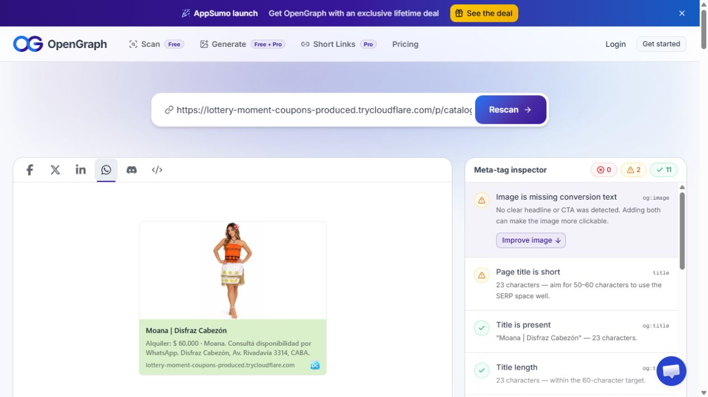
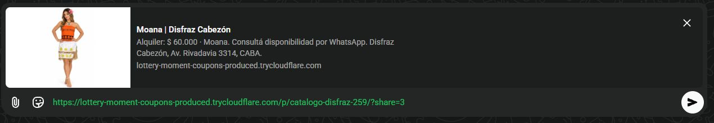

# Tanda 3 — confianza, compartir y medición

Draft desde main `1fc286d` (PR41 ya incluye Cloudflare Web Analytics). No se fusionó, no se desplegó Apps Script, no se creó hook/activador y no se guardaron datos de producción. Se hicieron lecturas del catálogo público, la ficha Google y el registro de búsquedas.

## Resultado

- Visitanos después del catálogo destacado y en el pie: dirección, horarios, mapa diferido, redes, medios de pago, envíos y siete preguntas desde las condiciones. Las fotos del local no aparecen mientras no haya imágenes guardadas. Rappi queda como campo opcional, sin enlace público inventado.
- Calificación inicial **4,7 · 717 opiniones · 05/11/2026**, indicada por el dueño y corroborada en Google. Visible también cerca de Encontrá tu disfraz y de Continuar en reservas, enlazando la ficha. Admin puede modificar o vaciar los campos; se oculta el dato incompleto. La fecha cambia al cambiar la calificación/cantidad, sin renovarse por subir fotos.
- Configuración del sitio solo admin; sube hasta cuatro fotos por Cloudinary y guarda la calificación, sus fotos/miniaturas y Rappi por `saveSiteInfo`. Rechazo en servidor de anónimos, editor, campos extra y valores inválidos, con límite de tamaño de propiedad.
- **1.224 fichas** públicas estáticas `/p/{id}/`, **1.231 URLs** en sitemap. Build total **1.241 páginas**. Las acciones refrescan disponibilidad; una baja posterior al build bloquea la reserva/compra al abrir la ficha. Los productos nuevos comparten el hash del catálogo hasta que su ruta existe.
- Metadatos con precio antes de la descripción, para que no lo corte un texto largo. Las fotos originales de Cloudinary usan una derivada horizontal 1200×630 con `c_lpad`: encuadre completo y relleno blanco, sin recorte ni ampliación de la foto. No se cambian la foto ni miniatura del catálogo. [Documentación del modo limit pad](https://cloudinary.com/documentation/image_padding_modes).
- Hook secreto solo en Script Properties y activador manual de instalación a las 03:00 de Argentina. Agrupa cambios de productos/categorías/precios/promos/tema; solo una solicitud diaria cuando hay revisión pendiente. Cambiar solo la calificación/fotos del local invalida su copia pública, pero no genera builds de productos. Un hook aceptado no equivale a deploy Live.
- Ocho grupos nuevos de sinónimos. La palabra **cana** no se toma dentro de *Mexicana*, *Americana* o *Canasta*: evita publicar resultados de policía para servilletas mexicanas. Las propuestas del registro están en [SINONIMOS_PROPUESTOS.md](SINONIMOS_PROPUESTOS.md), sin aplicarlas.
- Web, backend, PDF modelo y resumen imprimible local coordinados para devolver la garantía por transferencia después de revisar los trajes. Los contratos históricos conservan el texto firmado. [Instalación y reversión](INSTALACION.md).

## Validación

- **405 pruebas unitarias**: configuración/roles, límites, caché, hook diario, precios/promos, términos web/local, datos de las fichas y sinónimos. Incluyen la fecha de actualización en Argentina cerca de medianoche y el falso resultado Mexicana/policía.
- Build limpio: `.next` eliminado dentro del checkout verificado, `npm ci`, `npm run build`. Se generaron y auditaron las **1.224 fichas**: título/descripción, foto, precio, moneda, URL/sitemap y ausencia de `stock`, `insuranceDeposit` y `tariff` en el HTML. Esta auditoría forma parte del comando de build y cancela un deploy si falla.
- Matriz completa Playwright contra **out/**, con backend de prueba, en **360, 390, 768, 1093 y 1440**, ambos temas: **850 escenarios cubiertos**. La corrida global aprobó 830 y detectó 20 comparaciones con la portada anterior; se ajustaron esas comparaciones únicamente para excluir las adiciones de rating y Visitanos. Los **150 escenarios afectados** volvieron a pasar, incluidas esas 20 comparaciones. No se alteraron el carrito ni sus tests para obtener este resultado.
- Revisión adicional: **130/130** de Visitanos/configuración/compartir/analytics, incluido el beacon en `/p/spider/`, los campos vacíos, subida normal de foto simulada, persistencia del admin al cambiar de sección y rating dentro del primer pantallazo.
- Smoke adicional del build con el catálogo completo: móvil/escritorio en ambos temas; seis resultados legítimos para policía y ninguna servilleta mexicana. Sin escrituras ni formularios enviados a producción.
- QR A5 decodificado automáticamente y probado en navegador: abre Escribir una opinión de Cotillón Disfraz Cabezón. No se publicó ninguna opinión.
- Contrato: seis páginas renderizadas/revisadas, cinco páginas originales conservadas y suplemento coordinado; tildes, ñ, comillas y guiones conservados. Valores $60.000 / $75.000, garantías $60.000 / $100.000 y promos 2x1 / 3x2; sin $65.000 ni Premium.

## Lighthouse móvil

| Tema | Antes | Después | LCP antes | LCP después |
| --- | ---: | ---: | ---: | ---: |
| Normal | 97 | 95 | 1.96 s | 2.25 s |
| Halloween | 57 | 73 | 11.26 s | 7.30 s |

Lighthouse 13.6.0, emulación móvil y throttling por defecto, build exportado local de main contra el de esta rama. Una corrida por condición, misma copia pública de 1.224 productos y cuatro tarjetas verificadas al terminar. El puente Apps Script se simula con esa copia para no agregar localhost a los orígenes de producción; no representa la latencia real del backend. Analytics bloqueado durante la medición. El mapa no se descarga en el primer pantallazo. El tema normal cumple el mínimo de 90; Halloween sigue teniendo un LCP alto, visible en la tabla. Repetir en las URLs reales después de una instalación aprobada.

## Compartir: prueba externa

Se expuso temporalmente **solo la ficha pública de Moana**, sus assets estáticos y ningún formulario/admin, con endpoints de escritura deshabilitados. No se activó Preview en Render ni se cambió DNS. El túnel se cerró al terminar.

OpenGraph: **0 errores, 11 comprobaciones correctas, dos avisos** (título breve y ausencia de texto promocional sobre la foto). La imagen carga como JPEG de 25 KB, 1200×630. WhatsApp Web real: foto completa, título, alquiler $60.000 y descripción. Se preparó un borrador en el chat propio y se retiró sin enviarlo. La captura excluye chats y datos de terceros.

## Capturas públicas

Build local, copia del catálogo público, sin cuentas de clientes ni escrituras. Google Maps real en las capturas del mapa. La matriz automatizada incluye también los demás anchos.

| Vista | Normal · celular | Normal · escritorio | Halloween · celular | Halloween · escritorio |
| --- | --- | --- | --- | --- |
| Inicio y calificación | [390](capturas/default-390-inicio.png) | [1440](capturas/default-1440-inicio.png) | [390](capturas/halloween-390-inicio.png) | [1440](capturas/halloween-1440-inicio.png) |
| Visitanos | [390](capturas/default-390-visitanos.png) | [1440](capturas/default-1440-visitanos.png) | [390](capturas/halloween-390-visitanos.png) | [1440](capturas/halloween-1440-visitanos.png) |
| Mapa y pagos | [390](capturas/default-390-mapa.png) | [1440](capturas/default-1440-mapa.png) | [390](capturas/halloween-390-mapa.png) | [1440](capturas/halloween-1440-mapa.png) |
| Pie | [390](capturas/default-390-pie.png) | [1440](capturas/default-1440-pie.png) | [390](capturas/halloween-390-pie.png) | [1440](capturas/halloween-1440-pie.png) |
| Reservas y calificación | [390](capturas/default-390-reservas.png) | [1440](capturas/default-1440-reservas.png) | [390](capturas/halloween-390-reservas.png) | [1440](capturas/halloween-1440-reservas.png) |
| Ficha Moana | [390](capturas/default-390-moana.png) | [1440](capturas/default-1440-moana.png) | [390](capturas/halloween-390-moana.png) | [1440](capturas/halloween-1440-moana.png) |

## PDFs

- [QR imprimible A5](../../public/qr-opiniones-google.pdf), imprimir al 100%.
- [Contrato actualizado](../../public/Contrato_de_Alquiler_Disfraz_Cabezon.pdf).
- [Revisión visual del contrato](capturas/contrato.png) y [del QR](capturas/qr-a5.png).
